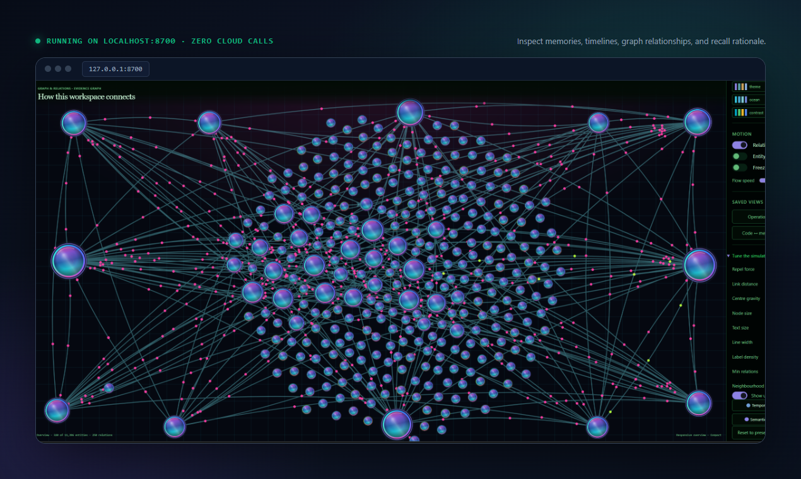

# Engraphis

[](https://pypi.org/project/engraphis/)
[](https://pypi.org/project/engraphis/)
[](https://github.com/Coding-Dev-Tools/engraphis/stargazers)
[](LICENSE)

**Your coding agent forgets decisions between sessions. Engraphis gives Claude Code, Cursor, and Codex one local memory store with receipts.**

Engraphis stores scoped project knowledge in SQLite, keeps temporal history instead of silently overwriting it, and returns cited context or abstains when the evidence is weak. The local core is Apache-2.0 and works offline.

[Watch the 56 second demo](https://www.youtube.com/watch?v=qw-rTnAA_Z4) · [Open the interactive demo](https://engraphis.com/demo) · [See how it compares](https://engraphis.com/product#comparison)

If this is useful, star the repo so other coding-agent users can find it.

## Install and connect an agent in three commands

Requires Python 3.10 or newer for the MCP server.

```bash
pip install "engraphis[mcp]"
engraphis-init
claude mcp add engraphis -- engraphis-mcp
```

`engraphis-init` writes a local config, generates an API token, and prints ready-to-paste setup for Claude Code, Codex, Cursor, Cline, Zed, and Windsurf. Restart your agent, then ask it to remember a project decision and recall it in a new session.

For Cursor, Cline, Zed, or Windsurf, paste the JSON block printed by `engraphis-init` into the client's MCP configuration. The full setup guide is [docs/AGENT_CONNECT.md](docs/AGENT_CONNECT.md).

<details>
<summary>Prefer the full local dashboard?</summary>

```bash
pip install "engraphis[all]"
engraphis-dashboard
```

The dashboard opens at [http://127.0.0.1:8700](http://127.0.0.1:8700). The `[all]` extra adds the embedding model, document import, and transcription dependencies. Most coding-agent users only need `[mcp]`.

</details>



## Why Engraphis

Coding agents are useful inside a session and forgetful across weeks. Compaction drops architectural decisions. A new session re-reads files it already understood. Flat vector search returns stale and current facts side by side, with no provenance and no way to tell which fact is still true.

Engraphis treats project knowledge as evidence:

- **Scoped:** workspace, repository, session, and record. Scratch decisions do not leak into repository conventions.
- **Temporal:** every fact carries world-time and system-time validity. Superseded facts close instead of disappearing, and `as_of` queries still work.
- **Grounded:** recall fuses vector, FTS5/BM25, Personalized PageRank, and AST code-symbol bridges, returns citations, or abstains.
- **Inspectable:** the local dashboard shows memories, timelines, graph relationships, recall rationale, and audit events.
- **Local:** one SQLite file, local embeddings, no mandatory cloud account or API key.

## What it provides

- **Continuity:** organize memories by workspace, repository, and session, with a last-session handoff.
- **Useful recall:** combine vector, lexical, graph, and code-aware retrieval, then pack results to a hard context budget.
- **Grounded answers:** preserve provenance and temporal history; cite support or abstain when it is insufficient.
- **Temporal history:** timeline views can include superseded versions, and the dashboard exposes an "Only superseded versions" filter. See [docs/ARCHITECTURE_V3.md](docs/ARCHITECTURE_V3.md) for the retrieval details.
- **Spec Studio:** inspect prompt specifications and scoped memory clusters with deterministic coverage, ambiguity, and conflict checks; review suggestions before changing memory.
- **Operator control:** keep the core local and offline-capable, with explicit controls for hosted services and external LLM providers.

## Use the Python service directly

```python
from engraphis.service import MemoryService

memory = MemoryService.create("engraphis.db")
memory.remember("Auth migrated from JWT to PASETO.", workspace="acme", repo="api")
hit = memory.recall("Why did we change auth?", workspace="acme", repo="api")
print(hit["context"])
```

## Benchmarks

The current registered artifact contains three deterministic offline fixture runs. It separates context size, retrieval quality, and grounded decision checks; these small fixtures do not establish general task performance.

<p align="center">
  
  <br>
  <sup>Three offline fixtures separate context reduction, candidate and packed retrieval quality, and grounded behavior. The chart shows the artifact checksum prefix; see the benchmark guide for the full checksum and reproduction steps.</sup>
</p>

| Fixture | Result | Quality check |
|---|---|---|
| Structure-aware chunking | Mean retrieved top-5 context: 740.3 → 214.3 tokens per question (71.1% lower, 18 questions) | Recall@5 = 1.000 in both modes |
| Recall payload proxy | JSON-shape proxy: 24,590 → 11,138 tokens (54.71% lower, 26 samples; 260 timed recalls) | Candidate and packed Recall@5, Hit@5, and answer-token recall are each 1.000 |
| Grounded decisions | 5/5 answerable queries grounded; 6/6 abstention queries rejected, including 1/1 quarantined-evidence check | 11/11 decisions correct |

The payload figure is a serialized JSON-shape estimate, not an MCP transport measurement or provider billing total. See the [Benchmark methodology](BENCHMARKS.md) for artifact identity, counting methods, reproduction commands, external-evaluation boundaries, and limitations.

## Pro and Team

The local core stays free and offline-capable. Pro and Team add hosted workflows for memory that has to follow you across agents, machines, and teammates:

- **See memory health:** analytics surfaces growth, retention, and decay forecasts so you can review what is becoming stale before it affects recall.
- **Keep memory maintained:** schedule Auto Consolidation and Auto Dreaming. They produce proposals for you to review, and local governance still decides what changes.
- **Sync across machines:** opt into encrypted Cloud Sync for eligible workspaces with a key you hold. Sync and readable managed processing are separate choices.
- **Give a team an operating picture:** named seats, admin/member/viewer roles, scoped credentials, and a 30-day account activity log visible to owners and admins. Shared hosted Team memory and hosted MCP are not yet available.
- **Add judgment with Jev:** Pro and Team include up to 500 managed Jev calls per person per day: typed, advisory checks for risky commands, contradictory memories, evidence support, and completion claims. No personal TypeSafe key or overage charge. Jev helps an agent separate safe from risky actions, contradictory from reinforcing memories, supported from unsupported answers, and complete from unfinished work, while permissions and tests stay in charge.

Pro is $10/month or $100/year for one owner. Team is $20/seat/month or $200/seat/year. Both start with an email-confirmed, no-card trial (7 active days for Pro, 14 active days for Team). [Compare plans](docs/HOSTED_PLANS.md) · [Start a Pro trial](https://api.engraphis.com/account?plan=pro&interval=monthly&utm_source=engraphis&utm_medium=readme&utm_campaign=pro_conversion&utm_content=readme_upgrade#billing) · [Start a Team trial](https://api.engraphis.com/account?plan=team&interval=monthly&seats=5&utm_source=engraphis&utm_medium=readme&utm_campaign=pro_conversion&utm_content=readme_team_upgrade#billing).

## Optional Jev assistance

**Jev is included free with every paid plan: Pro and Team.** Every legitimate Pro user and each eligible Team named seat, including paid viewers, with an active paid, trial, or test entitlement receives managed Jev at no additional customer charge and without a personal provider key. Local advisory decisions stay free for everyone; BYOK, a personal TypeSafe key, is optional for non-paid or direct use and its provider charges may apply. Managed Jev is available for paid plans; the hosted control service enables it with its provider key.

Each paid individual receives up to **500 Jev calls per person per day**, free. Usage is per person, not pooled across a Team and not monthly. Each evaluated call counts once, including a batched request; calls beyond the daily maximum are not served. Admitted attempts that fail or are interrupted remain counted, and no overage is charged. The account portal reports that member's remaining calls for the current day.

Use **Review with Jev** in the local dashboard for evidence-support and contradiction checks; the MCP decision tool covers command and completion reviews. Remote calls need per-call consent plus a `public` or `internal` classification, and Jev cannot write memories, change grounded-recall requirements, authorize commands, or certify completion.

Recall route selection is experimental and BYOK-only: `engraphis_recall_context` with `allow_remote=true`, or classic MCP with `planning="auto"` and `jev_assisted=true`. On 40 public synthetic tasks it changed no retrieval quality, so no retrieval-quality improvement is claimed.

See [hosted plans and Jev details](docs/HOSTED_PLANS.md#included-system-1-decision-engine-jev).

## Guides

- [Configuration reference](docs/CONFIGURATION.md)
- [MCP tool reference](docs/MCP_TOOLS.md)
- [Agent and LLM provider setup](docs/LLM_PROVIDERS.md)
- [Architecture and query planning](docs/ARCHITECTURE_V3.md#query-planning)
- [Docker deployment](docs/DOCKER.md)
- [Document import](docs/DOCUMENT_IMPORT.md)
- [Cloud Sync](docs/SYNC.md)
- [Pi extension](integrations/pi/README.md)
- [Spec Crawl and Spec Studio](docs/SPEC_CRAWL.md)
- [Memory write review](docs/WRITE_REVIEW.md)
- [Coding-agent file protection](docs/FILE_PROTECTION.md)
- [Security policy](SECURITY.md)
- [Hosted plans and licensing](docs/HOSTED_PLANS.md)

## License

Engraphis is licensed under Apache-2.0. The license does not grant trademark rights. See [LICENSE](LICENSE), [NOTICE](NOTICE), and the [licensing guide](docs/LICENSING.md). The hosted control plane and managed services are private services.
