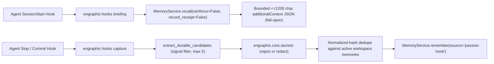

# Design: Engraphis v1.8 Zero-Friction Passive Capture, Session Briefings & Universal Agent Hooks

**Status:** Approved & Implemented (All EGM Goldfish Findings Resolved)  
**Repo:** `Coding-Dev-Tools/engraphis` (branch `feat/v1-8-passive-capture-hooks`)  
**Release:** Release 1 (`v1.8` - Beta-to-GA Zero-Friction Adoption)  

### EGM Goldfish Review Resolutions
- **CWD shadowing eliminated:** Moved CLI entrypoint inside `engraphis/hooks_cli.py` (`python -m engraphis.hooks_cli`, registered in `scripts/entry.py` + `pyproject.toml` as `engraphis-hooks`) so target repos containing `./scripts/` can never shadow or hijack hook execution.
- **Empty-query briefing fixed:** `build_session_briefing` branches cleanly to `service.recall_proactive()` when `query` is empty (catching missing-workspace `ValidationError`) and `service.recall(..., include_untrusted=False)` when non-empty.
- **Missing DB guard & embedding parity:** `briefing` short-circuits cleanly if the configured SQLite DB does not exist (never creates an empty DB on disk), uses lazy imports inside `--hook-mode` `try/except`, and passes `embed_model=settings.embed_model or None` to preserve existing semantic embedding spaces.
- **External poisoning & full-workspace dedupe:** Registered `"passive-hook"` in `engraphis/core/poisoning.py:EXTERNAL_SOURCES` (`review_state="pending"`, `prompt_eligible=False`) and deduplicated directly against SQLite active/pending/quarantined normalized hashes instead of `list_memories()`.
- **Per-client hook contracts:** Implemented distinct schemas for Claude Code (`SessionStart`/`Stop`, `hookSpecificOutput.additionalContext`), Cursor (`version: 1`, `sessionStart`/`afterAgentResponse` flat lists, `additional_context`, `workspace_roots` cwd fallback), and Command Code (detects `cc-engraphis-session-start` to prevent duplicate briefings), plus `Stop`/`afterAgentResponse` JSON/JSONL transcript parsing with `stop_hook_active` loop protection.

---

## 1. Problem Statement

Beta testers using Claude Code, Cursor, Codex, and Command Code install `engraphis[mcp]`, connect MCP, and then hit two adoption drop-off walls:

1. **Manual capture tax:** If an engineer or coding agent forgets to call `engraphis_remember`, important architectural decisions, bug root causes, and repo invariants evaporate at session end.
2. **Client-specific hook fragmentation:** Only Command Code has a bespoke installer (`scripts/install_cc_hook.py` -> `integrations/commandcode/session_start_hook.py`), and it only covers `SessionStart` (no passive post-session capture, no Claude Code `~/.claude/settings.json` or Cursor `.cursor/hooks.json` support, and no first-class `engraphis hooks` CLI verb in `scripts/entry.py`).

## 2. Goals & Non-Goals

### Goals
- Provide a **transport-agnostic, dependency-free core module** (`engraphis/hooks.py`) implementing:
  1. **Bounded Turn-0 Session Briefing (`build_session_briefing`)**: Deterministically retrieves the top approved/prompt-eligible workspace/repo memories (optionally scoped to changed files/query), packed strictly under `max_chars` (default `1200`), citing each memory ID, with zero network/LLM dependency and fail-open semantics.
  2. **Deterministic Passive Capture (`extract_durable_candidates` + `stage_passive_capture`)**: Scans a session summary, commit message, or hook transcript payload for high-signal durable engineering statements (decisions, invariants, root causes, fixes, conventions, `"never/always/must"` constraints), filters noisy debug chatter, enforces **fail-closed capture-time secret protection** via existing `engraphis.core.secrets` (`reject_secrets` / `redact_secrets`), deduplicates against active workspace memories, and writes via `MemoryService.remember(..., source="passive-hook")`.
  3. **Idempotent Client Hook Installer (`install_client_hooks` / `uninstall_client_hooks`)**: Supports `claude` (`~/.claude/settings.json`), `cursor` (`.cursor/hooks.json`), and `commandcode` (`~/.commandcode/settings.json`) with atomic writes, date-stamped first-write backups, `--dry-run`, and clean uninstall, strictly never overwriting unrelated user hooks.
- Expose a unified CLI front door `engraphis hooks` (`engraphis/hooks_cli.py`, registered in `scripts/entry.py` and `pyproject.toml` as `engraphis-hooks`) with subcommands:
  - `engraphis hooks install --client claude|cursor|commandcode [--settings PATH] [--no-stop] [--dry-run] [--uninstall]`
  - `engraphis hooks briefing [--db PATH] [--workspace W] [--repo R] [--query Q] [--max-chars N] [--json]`
  - `engraphis hooks capture [--db PATH] [--workspace W] [--repo R] [--stdin | --file PATH] [--secret-mode reject|redact] [--dry-run] [--json]`

### Non-Goals (Explicitly Deferred to Later PRs)
- Codex hook registration and `engraphis-init` automatic hook wiring (deferred to a follow-up slice).
- GitHub App webhook ingestion or remote Slack/Jira connectors (Release 1B / cloud worker).
- LLM-powered transcript summarization inside the hook hot path (hooks run strictly offline with `extractor="none"`, `graph_extractor="none"`, `retention_supervisor="none"`, and `DeterministicQueryPlanner()`).
- Replacing `scripts/install_cc_hook.py` or breaking existing Command Code hook keys (`cc-engraphis-session-start`, `cc-engraphis-file-guard`).

## 3. Architecture & Codebase Reuse

| Existing Primitive Reused | Why |
|---|---|
| `engraphis.core.secrets` (`reject_secrets`, `redact_secrets`, `SecretDetectedError`) | Reuses proven O(N) PEM/AWS/GitHub/GitLab/Slack/OpenAI/JWT/Bearer/DSN/assignment detectors instead of inventing a second regex list. |
| `engraphis.service.MemoryService` (`recall`, `remember`, `list_memories`) | Inherits all existing validation, receipt chain hashing, poisoning review gating (`source="passive-hook"`), and SQLite durability. |
| `scripts/entry.py` (`COMMANDS` dict) | Single lazy-loaded CLI front door; `engraphis hooks` never drags in FastAPI/torch. |
| Atomic backup-and-replace JSON pattern from `scripts/install_cc_hook.py` | Safe idempotent updates with `.bak-engraphis-YYYYMMDD` backup and no partial-write corruption. |

### Data Flow

### Secret & Poisoning Safety Contract
1. **Default secret mode is `reject` (fail-closed per candidate):** If a candidate sentence triggers `SecretDetectedError`, that candidate is **dropped** and counted under `skipped_secrets` (content-free count only; the secret value is NEVER logged, stored, or echoed). When `--secret-mode redact` is explicitly passed, `redact_secrets()` strips matched values before `reject_secrets()` re-validates the sanitized string (if still flagged, it is dropped).
2. **Poisoning boundary:** All passive captures record `source="passive-hook"` and `metadata={"capture_mode": "passive_hook"}` so reviewers and Team governance gates can distinguish auto-captured candidates from explicitly affirmed facts.
3. **Fail-open IDE guarantee:** Hook CLI entrypoints (`briefing`, `capture`) catch DB lock/missing-config/malformed-stdin errors when invoked in `--hook-mode` (default for installed hooks) and exit `0` with empty/status JSON so a local lock never wedges Claude Code or Cursor. Direct manual CLI invocations without `--hook-mode` return non-zero on invalid arguments or I/O errors.
4. **Cross-platform safety:** Prefers the sibling `engraphis-hooks` console wrapper or invokes `engraphis/hooks_cli.py` by its resolved absolute path (never adding CWD to `sys.path`) with explicit quoted paths and UTF-8 stdin/stdout on Windows, macOS, and Linux.

## 4. Concrete Interfaces & File Changes

1. **`engraphis/hooks.py`**: core passive capture, bounded briefing, and client hook installer.
2. **`engraphis/hooks_cli.py`**: argparse CLI (`install`, `briefing`, `capture`) with offline pinning and bounded input reads.
3. **`scripts/entry.py`**, **`pyproject.toml`**, **`scripts/smoke_entry_points.py`**: register `engraphis hooks` / `engraphis-hooks`.
4. **`tests/test_hooks_and_passive_capture.py`**: unit, adversarial security, poisoning quarantine, and CLI tests.

## 5. Verification Plan (Outside Judges)
- `pytest tests/test_hooks_and_passive_capture.py -q`
- `ruff check engraphis/hooks.py engraphis/hooks_cli.py scripts/entry.py tests/test_hooks_and_passive_capture.py`
- Verify Python 3.9 syntax compatibility (`from __future__ import annotations`).
