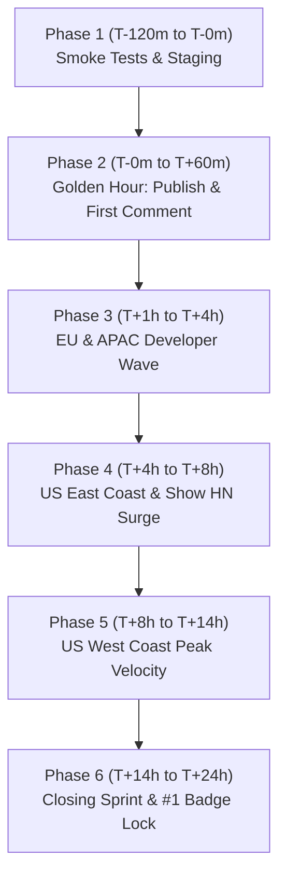

# Engraphis Product Hunt Launch: Operational Battle Plan & Defense Kit

**Target:** #1 Product of the Day | Flawless Execution | Maximum Developer Traction  
**Product:** Engraphis (Apache-2.0 Local-First Memory Engine for AI Coding Agents)  
**Launch Time:** 12:01 AM PT / 3:01 AM ET / 8:01 AM UTC  

---

## 1. Master T-120m to T+24h Hourly Execution Runbook

### Timezone Synchronization Reference Table
| Phase | Pacific Time (PT) | Eastern Time (ET) | UTC | Central European (CET) | India (IST) | Strategic Objective |
|---|---|---|---|---|---|---|
| **Phase 1** | T-120m to T-0m (10:00 PM - 12:00 AM) | 1:00 AM - 3:00 AM | 06:00 - 08:00 | 07:00 - 09:00 | 11:30 - 13:30 | Pre-launch verification, smoke tests, staging |
| **Phase 2** | T-0m to T+60m (12:01 AM - 1:00 AM) | 3:01 AM - 4:00 AM | 08:01 - 09:00 | 09:01 - 10:00 | 13:31 - 14:30 | **Golden Hour Sprint**: Publish, pin comment, VIP blast |
| **Phase 3** | T+1h to T+4h (1:00 AM - 4:00 AM) | 4:00 AM - 7:00 AM | 09:00 - 12:00 | 10:00 - 13:00 | 14:30 - 17:30 | Asia & Europe wake-up wave, international traction |
| **Phase 4** | T+4h to T+8h (4:00 AM - 8:00 AM) | 7:00 AM - 11:00 AM | 12:00 - 16:00 | 13:00 - 17:00 | 17:30 - 21:30 | **US East Coast Surge**: Show HN, X Thread, peak volume |
| **Phase 5** | T+8h to T+14h (8:00 AM - 2:00 PM) | 11:00 AM - 5:00 PM | 16:00 - 22:00 | 17:00 - 23:00 | 21:30 - 03:30 | **US West Coast Surge**: Silicon Valley wave, secondary peak |
| **Phase 6** | T+14h to T+24h (2:00 PM - 12:00 AM) | 5:00 PM - 3:00 AM | 22:00 - 08:00 | 23:00 - 09:00 | 03:30 - 13:30 | Evening consolidation, closing sprint, #1 badge lock |

Times use PST/EST (UTC-8/UTC-5), valid after DST ends on 2026-11-01. If the launch is scheduled while DST is in effect, recompute the UTC/CET/IST columns.

---

### Detailed Hourly Phase Execution



#### Phase 1: T-120m to T-0m  -  Pre-Launch Staging & Final Verification (10:00 PM - 12:00 AM PT)
- **T-120m (10:00 PM PT)  -  Local Infrastructure & Engine Smoke Gate:**
  1. Verify dashboard runs cleanly without runtime drift:
     ```powershell
     python -m scripts.start_dashboard
     ```
     Verify browser opens to `http://127.0.0.1:8700` and Inspector loads memory tables.
  2. Run the fast offline launch test gate:
     ```powershell
     python -m pytest tests/test_client_launch.py -q
     python scripts/check_commercial_manifest.py
     python scripts/externalize_dashboard_assets.py
     ```
  3. Validate MCP server connection endpoint (`http://127.0.0.1:8711/mcp` or stdio entry point).
- **T-90m (10:30 PM PT)  -  Product Hunt Staging Asset Audit:**
  - Verify Tagline: *"Local-first, bi-temporal memory engine for AI coding agents"*
  - Verify Category/Topics: `Developer Tools`, `Artificial Intelligence`, `Open Source`, `GitHub`.
  - Check Gallery Media:
    - Slide 1: Hero demo GIF (Engraphis remembering architecture decision & auto-injecting into Claude/Cursor).
    - Slide 2: Context token reduction comparison chart (71.1% drop, 740 to 214 tokens).
    - Slide 3: Unified Dashboard screenshot (port 8700 timeline & graph visualizer).
    - Slide 4: 4-Arm Hybrid Recall diagram (Vector + BM25 + PageRank + Code Graph).
    - Slide 5: Open source Apache-2.0 badge & local SQLite architecture diagram.
  - Check Maker Profiles: Jaixii (Founder/Lead) + Hunter profile verified and linked.
- **T-60m (11:00 PM PT)  -  Social & Community Pre-Draft Staging:**
  - Stage X (Twitter) launch thread in Typefully/TweetDeck.
  - Stage LinkedIn update draft.
  - Stage Show HN markdown draft (`Show HN: Engraphis - Local-first, bi-temporal memory for AI coding agents`).
  - Stage Discord/Slack messages across VIP channels.
- **T-30m (11:30 PM PT)  -  Staging Founder First Comment:**
  - Copy the finalized Founder First Comment (see below) into clipboard/scratchpad ready for instant post at T+0m.
- **T-10m (11:50 PM PT)  -  War Room Assembly:**
  - Founder and support teammates on live voice/Slack channel.
  - Refresh Product Hunt dashboard and hunter staging preview.

---

#### Phase 2: T-0m to T+60m  -  The Golden Hour Launch Sprint (12:01 AM - 1:00 AM PT)
*The first 60 minutes define algorithm weighting, initial trending rank, and feature positioning.*

- **12:01 AM PT  -  GO LIVE:**
  - Hunter / Maker hits **Publish**. Confirm listing is publicly visible on `producthunt.com`.
  - Extract and verify canonical URL: `https://www.producthunt.com/posts/engraphis`.
- **12:02 AM PT  -  Founder First Comment Drop:**
  - Immediately paste and submit the Maker First Comment. Pin it to the top.
- **12:05 AM PT  -  Core VIP & Alpha User Alert:**
  - Send direct 1-on-1 ping to the top 25 core alpha contributors and power users (via private Slack/Telegram/Discord).
  - *"We are officially live on Product Hunt! Would love your honest perspective and feedback in the discussion: [URL]"*
- **12:10 AM PT - 1:00 AM PT  -  Real-time Comment Sentry:**
  - Target: **100% response rate within 5 minutes** of any community comment.
  - Engage with every authentic comment to stimulate active dialogue threads.
  - Track initial leaderboard placement on PH front page.

---

#### Phase 3: T+1h to T+4h  -  Asia & Europe Wake-Up Wave (1:00 AM - 4:00 AM PT / 9:00 AM - 12:00 PM UTC)
- **Geographic Targets:** London, Berlin, Amsterdam, Paris, Bangalore, Singapore, Tokyo.
- **1:30 AM PT (9:30 AM UTC):**
  - Drop launch announcements into European-centric developer Discords (e.g., Python Discord, LocalLLaMA, AI Engineer Foundation).
- **2:30 AM PT:**
  - Monitor GitHub stars and inbound issues. Check `engraphis-init` onboarding feedback.
- **3:30 AM PT:**
  - Check leaderboard pacing. Benchmark engagement and comment velocity against #2 and #3 products of the day.

---

#### Phase 4: T+4h to T+8h  -  US East Coast Peak Morning Surge (4:00 AM - 8:00 AM PT / 7:00 AM - 11:00 AM ET)
*This is the highest volume traffic acceleration window of the entire launch cycle.*

- **4:30 AM PT (7:30 AM ET):**
  - Deploy **Show HN** post on Hacker News:  
    `Show HN: Engraphis - Local-first, bi-temporal memory for AI coding agents`
  - *Rule:* Direct GitHub repo link as main URL; top comment explains the technical depth and architecture.
- **5:00 AM PT (8:00 AM ET):**
  - Launch the primary **X / Twitter Mega-Thread**:
    - Tweet 1: Hook + Hero Video + Link to PH.
    - Tweet 2: The coding agent problem: Context amnesia & bloated prompt fees.
    - Tweet 3: How 4-Arm Recall + Bi-temporal validity fixes it.
    - Tweet 4: Apache-2.0 local-first architecture (SQLite, zero Docker, zero API keys).
    - Tweet 5: Link to GitHub repo + Product Hunt discussion.
- **6:00 AM PT (9:00 AM ET):**
  - Post to Reddit communities: `r/LocalLLaMA` (technical architecture focus), `r/selfhosted`, `r/MachineLearning`.
- **7:00 AM PT (10:00 AM ET):**
  - Send the Early User & Waitlist Newsletter blast (via email/Substack).
- **4:00 AM - 8:00 AM PT:**
  - Constant rapid response to Hacker News, Twitter mentions, and Product Hunt comments.

---

#### Phase 5: T+8h to T+14h  -  US West Coast Surge & Peak Competition (8:00 AM - 2:00 PM PT)
*Silicon Valley, San Francisco, Seattle, and tech investors/founders come online.*

- **8:30 AM PT:**
  - Post LinkedIn thought leadership update: Focus on engineering economics, agent context overhead, and developer tooling trends.
- **10:00 AM PT  -  Mid-Day Competition Audit:**
  - Inspect Product Hunt Leaderboard standings:
    - Measure delta in engagement and comment counts against #1, #2, #3 products.
    - Identify traffic sources and double down on highest converting channels.
- **11:30 AM PT:**
  - Publish Milestone Update #1 in PH comments and on X:  
    *"Over 500+ developers tested Engraphis today! Here is the #1 question we're getting about bi-temporal validity..."*
- **1:00 PM PT:**
  - Engage with AI influencers and creators who retweeted or commented on the thread.

---

#### Phase 6: T+14h to T+24h  -  Closing Sprint & #1 Badge Lock (2:00 PM - 12:00 AM PT)
- **3:00 PM PT (6:00 PM ET):**
  - Second-wind social push: Recap key insights, share screenshots of the localhost dashboard, invite remaining evening developers to check out the repo.
- **6:00 PM PT (9:00 PM ET / 11:00 AM next day Tokyo):**
  - Engage with APAC day 2 audience.
- **9:00 PM PT (T-3h to close):**
  - Pacing check: If in #1 spot, defend lead by maintaining 100% comment responsiveness. If trailing by <50 votes, execute targeted 1-on-1 direct outreach to uncontacted network contacts.
- **11:00 PM PT (T-60m to close):**
  - Post Founder Closing Comment on Product Hunt thanking the community for feedback, questions, and PRs.
- **12:01 AM PT  -  Launch Complete:**
  - Screenshot badge ranking (#1 Product of the Day / Top 3 Product of the Day).
  - Update GitHub README with the Product Hunt badge.

---

## 2. Founder Maker First Comment (To Pin at T+0m)

```markdown
Hey Product Hunt! 👋 I'm Jaixii, founder of Coding-Dev-Tools and creator of Engraphis.

If you’ve spent any time working with AI coding agents (Claude Code, Cursor, Aider, Cline, OpenCode, Codex), you’ve probably hit the "Context Amnesia Wall":
1. Every new session starts from zero. The agent forgets that you migrated from REST to gRPC two weeks ago, re-suggests deprecated libraries, and clutters your prompt with 20,000 tokens of redundant context.
2. If you put memories in a generic vector database, it hallucinates past decisions because it can't distinguish between what was true *last month* versus what is true *today*.
3. Or you're forced to spin up heavy Docker containers and send your proprietary codebase knowledge to third-party hosted cloud memory servers.

We built Engraphis to solve this from first principles.

Engraphis is a **local-first, open-source (Apache-2.0) memory engine designed specifically for AI coding agents**.

Here is what makes it fundamentally different under the hood:
• **Bi-Temporal Validity:** Every memory tracks both world-time (when a fact was true in your codebase) and system-time (when your agent learned it). Contradictions are resolved by closing validity windows - never by destructive overwrites. You can query your codebase memory `as_of` any git revision or point in time.
• **4-Arm Hybrid Retrieval:** We don't just do semantic cosine search. Engraphis fuses Vector Search + Lexical BM25 (FTS5) + Personalized PageRank graph retrieval over symbols and entities + Code Call-Graph awareness, ranked via Reciprocal Rank Fusion (RRF).
• **Grounded Recall with Explicit Abstention:** If a query doesn't have sufficient evidence support, Engraphis *abstains* instead of guessing or feeding irrelevant nearest-neighbors to your LLM.
• **71.1% Token Reduction:** In our registered offline benchmarks, structure-aware chunking dropped top-5 context size from 740.3 to 214.3 tokens per question with 1.000 Recall@5.
• **Zero Cloud Infrastructure Required:** It runs entirely on your local machine using SQLite (WAL mode) and local embeddings (NumPy / Sentence-Transformers). No Docker, no cloud account, no credit card.

You can spin it up right now via pip or run our local web dashboard at `localhost:8700`:
$ pip install "engraphis[all]"
$ engraphis-init
$ engraphis-dashboard

I'll be here all 24 hours in the comments answering every technical question, diving into our scoring algorithms, and discussing agent memory architecture.

I’d love to hear your honest feedback, critique of our retrieval pipeline, or what memory problems your coding agents are facing! 🚀
```

---

## 3. Live Comment Response Protocol & Skeptical FAQ Response Bank

### Comment Response SLA & Rules of Engagement
- **SLA:** Respond to every comment within **5 minutes** (maximum 15 minutes during late-night shift).
- **Rule 1  -  Zero Defensiveness:** Praise sharp skepticism. If someone points out a valid edge case, validate them immediately: *"That’s a great critique, and here is how we chose to make that trade-off..."*
- **Rule 2  -  Technical Precision over Marketing:** Cite real math, formulas, benchmarks, and file paths (`core/recall.py`, `core/resolve.py`, `core/schema.py`). Developers detect hand-waving instantly.
- **Rule 3  -  Provide Immediate Reproducibility:** Include exact CLI flags, benchmark reproduction commands, or code snippets.

---

### Top 6 Hardest Skeptical Questions & Ready-to-Send Responses

#### Q1: "How is this different from other memory frameworks or basic vector stores?"
```markdown
Great question! The short answer is: **scope hierarchy, retrieval topology, and temporal truth modeling.**

Most existing memory frameworks (including basic vector wrappers) treat memory as flat string chunks stored in a generic vector database with metadata tags. That works fine for a personal chatbot ("user likes espresso"), but it collapses in software engineering for three reasons:

1. **Native Coding Scope Hierarchy:** Coding agents operate across distinct layers: `workspace → repo → session → memory`. In Engraphis, session-level scratch decisions don't pollute repo-wide architecture conventions, and repo conventions don't bleed into other workspaces unless explicitly promoted. Every read requires a `SearchFilter`.
2. **4-Arm Hybrid Retrieval vs Vector-Only:** Dense vector cosine search is notoriously bad at exact code symbols (e.g. `getUserById` vs `getUsersById`), call chains, and lexical nuances. Engraphis executes four deterministic retrieval arms:
   • Vector (dense semantic cosine)
   • Lexical (SQLite FTS5 BM25 + LIKE fallback)
   • Graph (Personalized PageRank over extracted entities and code links)
   • Code-aware symbol/file/call bridges
   These are min-max normalized and fused via Reciprocal Rank Fusion (RRF, k=60).
3. **Bi-Temporal Validity vs Destructive Overwrite:** If you migrate from Webpack to Vite, vanilla vector stores retrieve *both* memories because both match "build tool configuration" with high semantic similarity, leaving the LLM hopelessly confused. Engraphis invalidates past facts by closing their `valid_to` timestamp while preserving historical lineage (`metadata.supersedes`), allowing `as_of` time-travel reads.
4. **Grounded Recall with Abstention:** Instead of forcing the top-K nearest neighbors into your prompt even when irrelevant, Engraphis computes absolute semantic and lexical support. If it's below `GROUNDED_SUPPORT_FLOOR`, it abstains rather than hallucinating facts.
5. **100% Local-First & Zero Infra:** No mandatory Docker containers, no remote servers, no hosted API dependencies.
```

#### Q2: "Why SQLite instead of a hosted vector database or a Postgres vector extension?"
```markdown
This was one of our most deliberate architectural decisions. Here is why:

1. **Developer Ergonomics & Zero Friction:** A coding agent runs on your local workstation or laptop. Requiring developers to install Docker, provision a vector-database container, or register for an external vector SaaS key before their agent can remember anything kills adoption. SQLite is embedded, zero-config, and runs everywhere Python runs.
2. **ACID Relational Integrity for Bi-Temporal Graphs:** Memory is not just vectors; it is a relational graph of scopes, sessions, bi-temporal validity intervals, entity links, and audit logs (`core/schema.py`, Schema v19). SQLite with WAL (Write-Ahead Logging) gives us immediate ACID durability, transactional consistency, and blazing-fast local joins.
3. **Embedded Vector Performance via `sqlite-vec` / NumPy:** For developer workstation memory (typically 1,000 to 100,000 memories per workspace), in-process vector search via `sqlite-vec` or our deterministic NumPy vector index executes in in-process latencies without the socket overhead or serialization penalties of separate client-server databases.
4. **Portability & Disaster Recovery:** Your entire agent memory lives in a single, clean `.db` file (e.g., `engraphis.db`). You can inspect it with standard SQLite tools, commit snapshots, back it up to Dropbox, or move it between machines without database migration headaches.
```

#### Q3: "What is bi-temporal validity and why does a coding agent need it?"
```markdown
Bi-temporal modeling tracks two separate time dimensions for every single piece of knowledge:
• **World-Time (`valid_from` / `valid_to`):** The real-world window during which the statement was true in your codebase.
• **System-Time (`ingested_at` / `expired_at`):** When the agent actually recorded and observed the fact.

**Why a coding agent breaks without it:**
Imagine this real scenario:
- In March, your team used Tailwind v3 (`valid_from = March 1, valid_to = NULL`).
- In October, you upgraded to Tailwind v4, which deprecates `tailwind.config.js` in favor of CSS `@theme` directives (`valid_from = October 1`).

In a standard vector store, both facts exist. If your agent asks *"How do we configure Tailwind fonts?"*, cosine similarity pulls both snippets. The agent mixes the two syntaxes, breaks your build, and wastes 15 minutes of your time.

**How Engraphis handles it:**
When the agent learns the October change, our deterministic write-resolution pipeline (`core/resolve.py`):
1. Detects the contradiction via token overlap + semantic cosine on same-scope neighbors.
2. Performs an **INVALIDATION, not an overwrite**: it updates Tailwind v3's `valid_to = October 1` and creates the Tailwind v4 memory with `metadata.supersedes = [mem_tailwind_v3]`.
3. Standard queries automatically filter `valid_to IS NULL`, giving your agent *only* the current reality.
4. Crucially, if you check out an older git release branch or debug a legacy tag, your agent can query `as_of="2026-04-01"` and retrieve the exact architectural state of your repository as it existed back then!
```

#### Q4: "Does this leak private code or secrets to third-party LLMs?"
```markdown
**No. Absolute privacy is the foundational premise of Engraphis.**

1. **100% Offline Core:** Engraphis runs entirely on your local machine. In fact, our default factory (`engraphis.create_memory_engine()`) runs with **zero network access** using a deterministic lexical/hashing embedder and NumPy index. It does not require any OpenAI, Anthropic, or external API keys to function.
2. **Local Model Support:** If you want dense semantic embeddings, you can run local Sentence-Transformers (`all-MiniLM-L6-v2`) locally on your CPU/GPU.
3. **Built-in Secret Filtering & File Protection:** Engraphis includes active secret scanners that block `.env` files, API keys, private tokens, and credentials from ever being written into memory chunks.
4. **Quarantined Evidence & Hard Gate:** Remote calls to our optional hosted services (like Cloud Sync or advisory Jev decisions) require explicit triple consent:
   • `offline_mode=false`
   • `allow_remote=true`
   • `data_classification="public"` or `"internal"` (any payload classified as `"secret"` is rejected outright at the boundary).

Your proprietary code, architecture notes, and session logs stay strictly on your local disk.
```

#### Q5: "How does the 71.1% token reduction actually work?"
```markdown
The 71.1% figure comes directly from our registered, deterministic offline benchmark suite (artifact SHA-256 prefix `3b1d2127e290`, reproducible via `python -m eval.harness`).

Here is how we achieve it without losing retrieval accuracy:

1. **Structure-Aware Chunking vs Naive File Dumps:** Instead of dumping an entire 800-line file into context, Engraphis extracts discrete, typed architectural units (decisions, conventions, symbol interfaces, procedural steps). In our top-5 retrieved context test, mean tokens per question dropped from **740.3 tokens to 214.3 tokens (71.1% reduction)** while maintaining **Recall@5 = 1.000** and **Hit@5 = 1.000**.
2. **Context Budget Packing:** Most memory tools return arbitrary JSON payloads. Engraphis's `engraphis_recall_context` MCP tool packs retrieved facts into a strictly bounded token budget, deduplicating overlapping evidence and eliminating conversational filler.
3. **Abstention Eliminates Noise:** Traditional RAG injects the top-K chunks even if they are irrelevant, bloating prompt costs. Engraphis's `GROUNDED_SUPPORT_FLOOR` abstains when support is insufficient, injecting zero tokens when nothing relevant is known.
4. **JSON-Shape Proxy Reduction:** In serialized JSON payload evaluations across 26 samples and 260 timed recalls, context size fell by **54.71%** (from 24,590 to 11,138 tokens).

You can reproduce this exact benchmark on your own machine in 10 seconds:
```bash
python -m eval.harness --dataset eval/datasets/sample.jsonl --k 5
```
```

#### Q6: "Is it really free, and what is behind the paid tier?"
```markdown
**Yes. The entire core software is 100% free and open source under Apache-2.0.**

**What is 100% Free & Open Source Forever:**
• The complete Memory Engine (bi-temporal validity, Ebbinghaus decay, 4-arm hybrid recall).
• The SQLite storage engine and vector index.
• The full Local Web Dashboard (`engraphis-dashboard` at `http://127.0.0.1:8700`).
• The complete Model Context Protocol (MCP) server for Claude Code, Cursor, Windsurf, OpenCode, and Codex.
• Local document import, manual consolidation, and local workspace export.
• There are no artificial memory caps, no query throttling, and no local paywalls.

**What is in the Paid Hosted Tiers (Pro $10/mo, Team $20/seat/mo):**
Our commercial tiers provide optional hosted infrastructure for developers and teams who want cloud conveniences without compromising their local data:
• **Hosted Cloud Sync (Pro):** Zero-friction, end-to-end encrypted sync between your laptop, desktop workstation, and remote dev servers.
• **Managed Automation:** Cloud-scheduled memory consolidation and dreaming passes so you don't have to run background cron jobs locally.
• **Team Multi-User Dashboard (Team):** Centralized team conventions, shared repository memory workspaces, access control roles, and audit log exports.
• **Included System 1 Decision Engine (Jev):** Managed advisory decision quotas included without needing your own API key.

If you just want a killer, offline-first memory engine for your coding agent on your own machine, you will never pay a penny.
```

---

## 4. Direct Community & Network Outreach Playbook

### Strict Product Hunt Anti-Spam / Anti-Vote-Begging Compliance
> [!IMPORTANT]
> **Product Hunt Rule:** NEVER ask for "upvotes", "votes", "support our launch", or use the word "vote". PH's fraud-detection algorithm penalizes listings that receive vote rings or coordinated upvote blasts.
> **Compliant Messaging:** ALWAYS ask for *"authentic feedback"*, *"thoughts on the technical architecture"*, *"checking out our launch discussion"*, or *"trying it out with your coding agent"*.

---

### Outreach Message Templates

#### Template 1: Discord & Slack Developer Communities (Cursor, Aider, Cline, Continue, AI Engineers)
```text
Hey everyone! 👋 

If you use AI coding agents (Claude Code, Cursor, Aider, OpenCode), you've probably dealt with the agent forgetting past architectural decisions or spewing hallucinated config options from two releases ago.

Today we open-sourced **Engraphis** (Apache-2.0)  -  a local-first memory engine for coding agents that runs on SQLite, supports bi-temporal validity (so past invalidated decisions don't poison present queries), and cuts context token usage by ~71% via 4-arm hybrid recall.

We just launched on Product Hunt today and would love to get your honest technical critique on our retrieval pipeline and architecture:
👉 https://www.producthunt.com/posts/engraphis

The GitHub repo is 100% open source: https://github.com/Coding-Dev-Tools/engraphis

Curious how you all are handling long-term memory in your agent setups!
```

#### Template 2: 1-on-1 Personalized DM to Developer Friends & Open-Source Maintainers
```text
Hey [Name]! Hope you're having a great week. 

Quick update: we just launched Engraphis on Product Hunt today! It’s the local-first, bi-temporal memory engine for AI coding agents we’ve been building in Engraphis.

Knowing your experience with [developer tools / agentic workflows / Python / local LLMs], I would genuinely love to get your thoughts on how we structured our bi-temporal validity and 4-arm recall pipeline.

Here’s the launch page if you want to check out the demo and drop a comment:
👉 https://www.producthunt.com/posts/engraphis

No pressure at all, but would love your honest perspective on the discussion page!
```

#### Template 3: Email to Early Alpha Users & Waitlist Testers
```text
Subject: Engraphis is officially live on Product Hunt! 🚀 (Local-first memory for coding agents)

Hi [First Name],

Over the past few months, your feedback on our early builds helped shape Engraphis into what it is today: a fast, local-first, bi-temporal memory engine that gives AI coding agents persistent context without sending your proprietary code to third-party clouds.

Today, Engraphis is officially live on Product Hunt!

Check out our launch page here:
👉 https://www.producthunt.com/posts/engraphis

What we’ve launched today:
• Full Apache-2.0 open-source release on GitHub
• Unified Local Dashboard & Inspector at localhost:8700
• 4-Arm Hybrid Retrieval (Vector + BM25 + PageRank + Code Call-Graph)
• 71.1% verified context token reduction

We would love for you to join the conversation on Product Hunt today. If you've tested Engraphis, please drop your honest thoughts, experiences, or questions in the comment section - your authentic perspective means the world to our small team.

Thank you for being part of our early journey!

Best regards,
Jaixii and the Engraphis team
https://github.com/Coding-Dev-Tools/engraphis
```

#### Template 4: Social Announcement Post for X (Twitter)
```text
Coding agents have a massive amnesia problem. 

Every new session forgets past decisions, suggests outdated libraries, and wastes 20,000 prompt tokens re-reading old files.

Today, we're launching Engraphis: a local-first, open-source memory engine for AI coding agents. 🧠⚡

Here is how we solved it: 🧵👇
[Attach 30s Demo Video / GIF]

1/ Bi-Temporal Truth Modeling
Codebases evolve. When you migrate from REST to GraphQL, vanilla vector stores retrieve both. 
Engraphis invalidates old facts by closing their validity window - never by destructive overwrite. Query your memory as_of any git commit.

2/ 4-Arm Hybrid Retrieval
Dense vector cosine isn't enough for code. We fuse:
• Semantic Cosine
• SQLite FTS5 BM25
• Personalized PageRank over code graphs
• Code symbol/call-graph bridges
Fused via Reciprocal Rank Fusion (RRF).

3/ 71.1% Token Reduction
Structure-aware chunking dropped top-5 context size from 740.3 to 214.3 tokens per question with 1.000 Recall@5 in registered benchmarks.

4/ 100% Local-First & Apache-2.0
Runs on SQLite with WAL mode. Zero Docker containers. Zero external LLM keys required.

We are live on Product Hunt today! We'd love your honest feedback and questions:
👉 https://www.producthunt.com/posts/engraphis

Star the repo on GitHub:
⭐ https://github.com/Coding-Dev-Tools/engraphis
```

#### Template 5: LinkedIn Post for Engineering Leaders & AI Practitioners
```text
Most AI coding assistants today suffer from severe context amnesia. 

They treat every prompt like the beginning of time. Or worse, teams try to bolt on generic vector databases that treat code decisions like simple text snippets - resulting in hallucinated configurations, architectural drift, and exploding token bills.

Today, we are excited to launch Engraphis on Product Hunt: an Apache-2.0 local-first memory engine designed specifically for AI coding agents.

Key engineering highlights:
🔹 Bi-temporal validity: Separates when a code decision was true from when the agent learned it, allowing point-in-time historical reconstruction without destructive overwrites.
🔹 4-Arm hybrid retrieval: Fuses vector cosine, BM25 lexical search, Personalized PageRank, and code call-graphs via Reciprocal Rank Fusion.
🔹 Grounded recall with abstention: If query support is below our threshold, the engine abstains rather than feeding speculative noise into your LLM prompt.
🔹 Zero cloud infrastructure: Runs locally on SQLite in-process. No Docker daemons, no external API dependencies, and no proprietary code leaking to third parties.

We're live on Product Hunt today and would value your perspective, critique, and feedback on our architecture:
👉 https://www.producthunt.com/posts/engraphis

GitHub Repository: https://github.com/Coding-Dev-Tools/engraphis
```

---

## 5. Operations War Room Checklist & Emergency Protocol

| Issue | Detection Trigger | Immediate Response Action | Owner |
|---|---|---|---|
| **Localhost Dashboard Port Conflict** | Port 8700 already occupied on dev machine | Run with custom port: `python -m scripts.start_dashboard --port 8705` or kill orphan process | Lead Dev |
| **Product Hunt Listing Image Glitch** | Images fail to render or crop weirdly on mobile | Re-upload 1270x760 PNG assets immediately from `docs/images/` staging folder | Ops Lead |
| **Hacker News Flagging / Dead Post** | Post marked [flagged] or missing from 'newest' | Do NOT brigade or ask for upvotes. Message HN mods politely with direct technical summary | Jaixii (Founder) |
| **Aggressive Skeptic in PH Comments** | Hostile question accusing of "just a wrapper" | Deploy FAQ Response Q1 within 5 minutes; maintain radical transparency, cite `core/recall.py` | Founder |
| **Leaderboard Pacing Lag (Falling below Top 3)** | Vote delta >40 votes behind #3 at T+6h | Activate Phase 4 / Phase 5 personalized 1-on-1 outreach wave; ping European & East Coast devs | Community Lead |
| **GitHub Stars Spike / Rate Limit on API** | GitHub issue tracker spam or rate limiting | Maintain pinned FAQ issue with quickstart tips; link directly to local offline instructions | Lead Dev |

---
*Operational Plan approved. All assets, scripts, and responses staged for 12:01 AM PT launch.*
